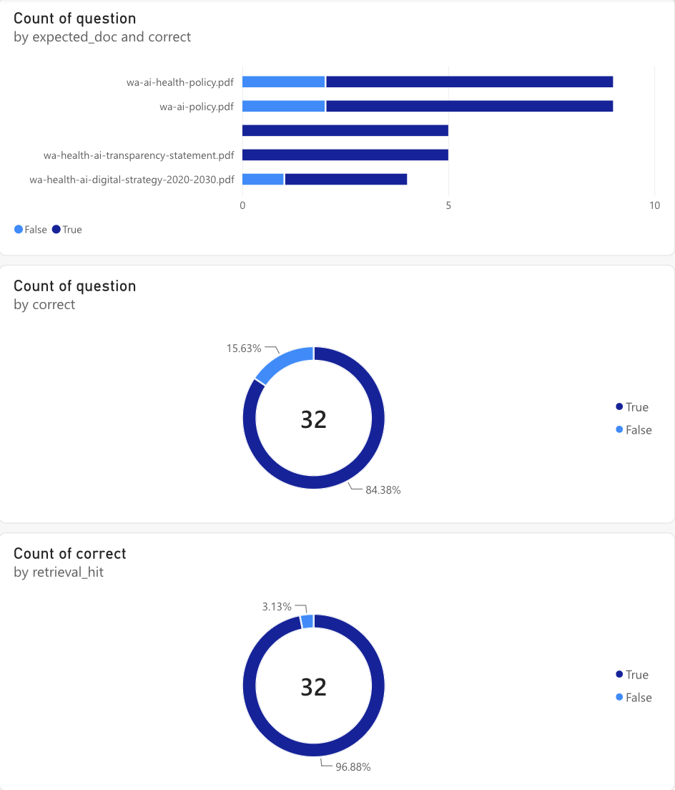

# RAG assistant over public standards

A retrieval-augmented generation (RAG) assistant that answers natural-language questions about public policy and standards documents, with answers grounded in — and cited to — the source text.

Built as a standalone project to demonstrate an enterprise-style document Q&A pipeline end to end, including evaluation.

## What it does
- Ingests PDFs, splits them into overlapping chunks, embeds them and stores them in a local FAISS index
- Retrieves the most relevant chunks for a question and generates an answer that cites document and page
- Refuses to answer when nothing relevant is retrieved, to limit hallucination
- Ships with an evaluation harness: retrieval hit rate, LLM-graded answer correctness and latency

## Documents used
Five publicly available Western Australian Government documents: the WA Government AI Policy, the WA Government AI Assurance Framework, the WA Health AI Policy, the WA Health AI Transparency Statement and the WA Health Digital Strategy 2020–2030. No private or proprietary data.

## Results

| Metric | Baseline | After tuning |
|---|---|---|
| Retrieval hit rate @6 | 93.8% | 96.9% |
| Answer correctness (LLM-graded vs reference) | 78.1% | 84.4% |
| Median response time | 1.55 s | 1.29 s |

Evaluation set: 32 hand-written questions across the 5 documents, including 2 cross-document questions and 5 unanswerable ones (4 on-topic "near misses" to test refusal). Run `python eval/run_eval.py` to reproduce.



## Design notes
- **Document-name boosting** on top of embedding similarity, added after finding that near-identical sections in different documents (e.g. the fairness principle) were retrieved from the wrong source
- **Refusal threshold** calibrated on unanswerable questions: off-topic queries score ≤ 0.17, on-topic ~0.55+, short factual questions ~0.35, so the threshold sits at 0.33
- **Larger chunk overlap and top-k** after seeing answers drawn from an adjacent section on the same page
- Every answer cites the excerpt it came from, so each claim can be checked against the source page
- Correctness is graded by a separate LLM call against a hand-written reference answer, so it is measured rather than assumed

## Stack
Python · OpenAI embeddings (`text-embedding-3-small`) and chat (`gpt-4o-mini`) · FAISS · pypdf

## Run it
```bash
pip install -r requirements.txt
cp .env.example .env          # add your OpenAI API key
# put PDFs in data/
python ingest.py
python ask.py "What must an entity do before deploying an AI system?"
python eval/run_eval.py
```

## Project structure
```
common.py             config, embedding helper
ingest.py             PDF -> chunks -> FAISS index
ask.py                question -> retrieval -> cited answer
eval/questions.json   hand-written evaluation set
eval/run_eval.py      scoring script
```